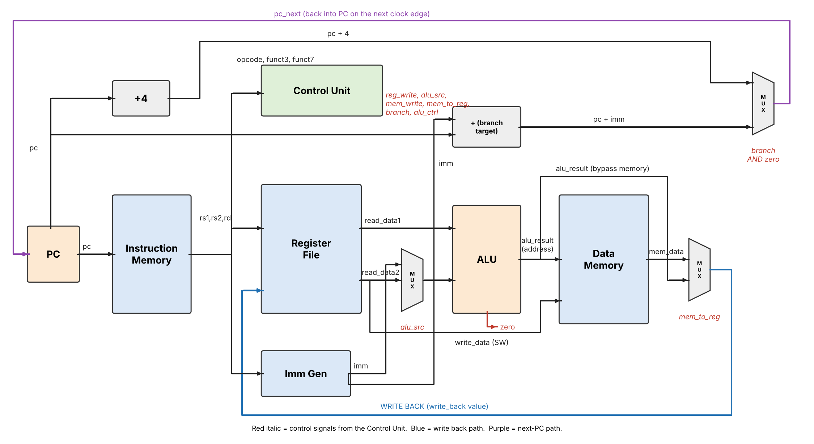

# Single-Cycle RISC-V Processor in Verilog

A simple, beginner-friendly **single-cycle RISC-V processor** written in Verilog as a college semester project.
Every instruction is fetched, decoded, executed and written back in **one clock cycle**.



## Supported instructions (subset of RV32I)

| Type | Instructions |
|---|---|
| R-type | `ADD`, `SUB`, `AND`, `OR` |
| I-type | `ADDI`, `LW` |
| S-type | `SW` |
| B-type | `BEQ` |

## Files

| File | Description |
|---|---|
| `program_counter.v` | Holds the address of the current instruction |
| `instruction_memory.v` | Stores the program (test program is loaded here) |
| `register_file.v` | 32 registers `x0`–`x31` (`x0` is always 0) |
| `alu.v` | Add, subtract, AND, OR + zero flag |
| `control_unit.v` | Decodes the instruction and generates control signals |
| `imm_gen.v` | Extracts and sign-extends the immediate |
| `data_memory.v` | RAM used by `LW` / `SW` |
| `riscv_cpu.v` | Top module – connects everything (includes the 3 multiplexers) |
| `testbench.v` | Generates clock/reset, runs the program and checks results |
| `cpu.gtkw` | GTKWave layout with the important signals pre-loaded |
| `sim_output.txt` | Output of a successful simulation run |
| `RISC-V_Single_Cycle_Complete_Guide.pdf` | Full explanation, viva questions and report |

## How to run

Requires [Icarus Verilog](https://steveicarus.github.io/iverilog/) (and optionally GTKWave).

```bash
iverilog -o cpu_sim *.v   # compile
vvp cpu_sim               # run the simulation
gtkwave cpu.gtkw          # (optional) view waveforms
```

## Test program

| PC | Instruction | Result |
|---|---|---|
| 0 | `addi x1, x0, 12` | x1 = 12 |
| 4 | `addi x2, x0, 10` | x2 = 10 |
| 8 | `add x3, x1, x2` | x3 = 22 |
| 12 | `sub x4, x1, x2` | x4 = 2 |
| 16 | `and x5, x1, x2` | x5 = 8 |
| 20 | `or x6, x1, x2` | x6 = 14 |
| 24 | `sw x3, 0(x0)` | Mem[0] = 22 |
| 28 | `lw x7, 0(x0)` | x7 = 22 |
| 32 | `beq x3, x7, 8` | taken → PC = 40 |
| 36 | `addi x8, x0, 1` | skipped |
| 40 | `addi x9, x0, 99` | x9 = 99 |
| 44 | `beq x0, x0, 0` | loop (end) |

## Expected output

```
========== FINAL CHECK ==========
  PASS  x1 = 12
  PASS  x2 = 10
  PASS  x3 = 22
  PASS  x4 = 2
  PASS  x5 = 8
  PASS  x6 = 14
  PASS  mem[0] = 22
  PASS  x7 = 22
  PASS  x8 = 0
  PASS  x9 = 99
  PASS  PC = 44
>>> ALL TESTS PASSED <<<
```

## Limitations

Only 8 instructions, no pipelining, no jumps (JAL/JALR), small fixed memories, and the program is hard-coded in instruction memory. See the PDF for details and future scope.
